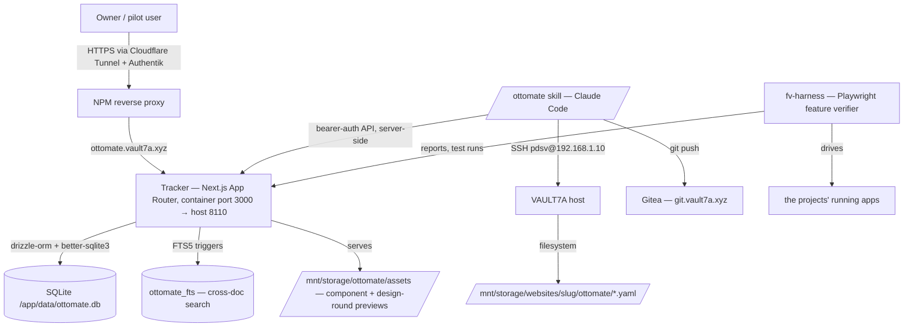

# Ottomate — Architecture

> arc42-lite, as of 2026-09-07. Hand-written explanation (Layer 2 of the documentation standard). This doc says *why*
> and *how the parts fit*; the list of features, flows and pages lives in the registry and is rendered into
> [FEATURES.md](FEATURES.md) and the showcase — never restated here.

## 1. Introduction & goals

Ottomate is two halves that only work together:

- **The skill** (`/ottomate`, a Claude Code plugin — Gitea `pdsv/ottomate`) owns judgment: dialogs, stage routing,
  lock-in gates, sub-agent dispatch. It carries no state.
- **The tracker** (this repo — Gitea `pdsv/ottomate-tracker-v3`) owns state, gates and evidence: the registry of every
  VAULT7A web project (features, flows, pages, acceptance criteria, ADRs, risks), the ledger of what was claimed,
  verified, deployed and decided, and the rules that catch the difference.

The goal is a pipeline in which an AI can build and iterate real projects **without gaslighting the owner**: nothing is
"done" because the model said so — it is done when an independent verifier, a real test run, or the owner's explicit
lock says so, and the tracker can prove it.

Quality goals, in order: truthfulness of state · owner control at every gate · recoverability of the record ·
low ceremony for the common path.

## 2. Constraints

- **Self-hosted, free, single box.** Everything runs on VAULT7A; no paid services, no hosted platforms (adr-014
  pruned every tool that had been "locked" in docs but never deployed).
- **One SQLite file** (`/app/data/ottomate.db`) is the whole state. Convenient, and the reason for the strictest rule in
  the system (§8, adr-018).
- **The API is the only door.** Both halves talk only through `/api/*`; the skill never opens the database.
- **One checkout, two paths.** `/opt/homeserver/ottomate` is the deployed checkout (the container builds from it);
  `/mnt/storage/websites/ottomate` is a symlink to it, so the tracker has the same project-view path every other
  project has (YAML mirrors, docs, evidence). Inside the container that symlink dangles — `/repos` mounts
  `/mnt/storage/websites`, not `/opt/homeserver` — so anything the showcase reads from `/repos/ottomate/...` sees nothing.
- Two-person team at most (owner + AI sessions), often several sessions concurrently — every convention assumes a
  sibling session may be on the box at the same time.

## 3. Context (C4 level 1)

The tracker is the only component that sees every project. The skill sees one project per session; the harness sees
one app per run; the owner sees the showcase.

## 4. Solution strategy

- **Registry as the single source of truth.** Features, flows, pages, ACs and decisions are rows. Every document that
  restates them is generated from them or explains them (adr-016, adr-024).
- **Gates that reference only real state** (adr-014). A gate is a query over ledger tables; if the tables are empty the
  gate detects nothing, so every transition writes a ledger row.
- **Independent verification.** A coder session may not certify its own work: the code verifier and the feature
  verifier are separate agents whose inputs are the locked manifest and the diff, never the coder's claims.
- **Ramps, not switches.** Enforcement per project moves `off → warn → block` (`verify_gate`, `doc_gate`) so a rule is
  proven to fire before it can stop anything.
- **Drop-with-reason.** Nothing is silently deferred; the API refuses closures without a reason, and cancellations
  carry theirs onto every item they strand.

## 5. Building blocks (C4 level 2/3)

- **`app/api/*`** — the API boundary. GET is open (the showcase and the skill read freely); every mutation requires the
  bearer token (`.token`, a Docker secret) and passes `lib/api.ts` `readAuthBody`, which also refuses writes when the
  database file descriptors point at deleted inodes (adr-018) and reports body keys the schema stripped (#688).
- **`lib/db/`** — drizzle schema + journaled migrations (`lib/db/migrations/00NN_*.sql`) applied at boot by `getDb()`,
  with `fresh-catchup.sql` reproducing the early un-journaled deltas on an empty database. FTS5 is set up after.
- **The registry tables** — `projects`, `features` + `acceptance_criteria`, `flows` + steps, `pages`, `components`,
  `adr_index`, `risk_instances`, `project_todos` (the to-do model: state / kind / blocked_on / priority / origin /
  blocked_by / body — misc buckets are counted, not hidden).
- **The ledger tables** — `skill_events` (session beacons and notes), `verification_reports` and
  `feature_verification_reports` (verifier verdicts, per target and commit), `test_runs`, `deploy_artifacts`,
  `feature_claims`, `design_decisions`, `violation_writeoffs`, `reports` + `iterations` + `iteration_items` (Stage 4).
- **`app/api/anti-gaslight/violations`** — the rule engine: unclaimed-done, missing-acceptance, silent-drops,
  stale-verification, untested-deploys, unverified-ship, unreconciled-claim, dead-capability, unbacked-pass, stale-spec.
  Each is a query; severity HARD/SOFT; write-offs keep a row visible without blocking (#613).
- **`app/api/verify/gate` + `sanity-check`** — the deploy ship-gate and the eight bootstrap checks the skill runs at
  every session start (server liveness, disk, schema, token, clock, WAL integrity, …).
- **`app/projects/[slug]/*`** — the showcase: overview / features / flows / pages / architecture (workflow → system →
  curated decisions, adr-017) / progress / design (design-round picks) / components-pick. Build rails (non-goals,
  must-haves, risks, verifier output) are captured but never rendered — capture ≠ display.
- **`app/api/previews/*`** — serves the asset library (`master_components`, 266 entries on disk under
  `/mnt/storage/ottomate/assets/components`) and design-round previews.
- **`scripts/`** — `write-yaml-mirror.ts` (adr-018 recovery net), `generate-api-inventory.sh` (the only authoritative
  route list), `register-unregistered-components.mjs`, `backfill-todo-model.mjs`, `build-previews.mjs`.
- **`/opt/homeserver/fv-harness`** (outside this repo) — the Playwright feature verifier: case matrices per feature/flow,
  `run.mjs` conductor, nightly, `fv-drift.sh` (refuses to run a runner that drifted from an app repo), `coverage.mjs`
  (which targets have a matrix, state oracles, a current verdict, and have ever gone red).

## 6. Runtime scenarios

**Session start.** The skill calls `GET /api/sanity-check?phase=bootstrap`, then the project's context packet, the
open to-dos (`?open=1`, with the owner queue), the design ledger, and routes by state (`command-routing.md`).

**A Stage-4 iteration.** Owner text or a DOM-commenter batch → `POST /reports` → classifier → `POST /reports/{id}/classify`
→ items with confidence and source substrings → the **lock-in gate** (the owner confirms what was extracted before any
code) → `build-status` (progress only; it can never close an item) → the code verifier posts `verifier-result` → the
feature verifier drives the real app and posts a report + test run → `integrate` (refuses while any item is open;
`doc_gate=block` also demands the spec was updated) → deploy artifact → the ship-gate.

**Pack-up.** YAML mirror written and committed, generated docs regenerated, doc-lint run, to-do states set, a
`session-packed-up` beacon posted (the next session's quick-resume keys off it), repos pushed.

**Container rebuild.** Commit first (rule 7) → `POST /api/backup` (`VACUUM INTO`, adr-015) → `docker compose up -d
--build` in `/opt/homeserver/ottomate` → migrations apply at boot → health + a probe of the change.

## 7. Deployment

One container (`ottomate`) from `docker-compose.yml` + `Dockerfile` in `/opt/homeserver/ottomate`, host port 8110,
data volume `data/` (database, `backups/`), the bearer token as a Docker secret. Public entry
`https://ottomate.vault7a.xyz` through the Cloudflare tunnel, NPM and Authentik forward-auth for the UI; the API path
answers 401 to unauthenticated mutations itself. Nightly (`/opt/homeserver/scripts/ottomate-nightly.sh`): backup,
drift check, feature-verify (owner-suspended since 2026-08-28), preview rebuild. Backups also before every rebuild.

## 8. Cross-cutting concepts

- **Bearer auth** — `architecture/auth-flow.mmd`: GET open, mutations bearer-only, token file mode 600.
- **ONE DOOR (adr-018)** — never open the database with a second client while the container runs; both 2026-06 data
  losses came from exactly that. Forensics: back up first, read the dead snapshot.
- **Migrations first** — schema changes are journaled SQL plus the drizzle schema; the fresh-DB path must survive
  (every journaled ALTER on a catch-up-created table carries a `CREATE TABLE IF NOT EXISTS` guard).
- **Ledger writes on every transition** — a rule that reads an empty table detects nothing.
- **Secrets** — gitleaks pre-commit in this repo; no secret literal in any doc or skill file (the server-ops skill was
  scrubbed to point-of-use reads on 2026-09-07).
- **Documentation standard** — Layer 0 registry → Layer 1 generated (`FEATURES.md`, the showcase) → Layer 2 hand-written
  (this file, README, ADRs, `public_docs/`) → Layer 3 operational (`CODING_GUIDELINES.md`, YAML mirror, API inventory).
  `doc-lint` (Vale + lychee + native checks) runs at pack-up; `doc_gate` ramps enforcement.

```mermaid
graph LR
    Pilot[Owner / pilot] -->|raw text or DOM-commenter batch| Reports[(reports — pending)]
    Reports -->|classifier| Items[(iteration_items — with confidence + source substring)]
    Items -->|lock-in gate: owner confirms| Locked[iteration locked]
    Locked -->|coder session| Build[(build-status — progress only)]
    Build -->|code verifier + feature verifier| Verdicts[(verification reports + test runs)]
    Verdicts -->|integrate: all items closed| Deploy[(deploy artifact + ship-gate)]
    Deploy -->|pack-up| Mirror[YAML mirror + FEATURES.md + doc-lint]
    Mirror -->|commit + push| Gitea[Gitea]
```

## 9. Decisions

The curated list renders on the showcase architecture page (adr-017). The record is `decisions/`:

- [adr-012](decisions/adr-012-codex-round-3-rejected.md) — Codex review round 3 rejected: the review's premises were wrong.
- [adr-013](decisions/adr-013-pilot-order-changed.md) — pilot order changed.
- [adr-014](decisions/adr-014-toolchain-pruning.md) — gates reference only deployed tools.
- [adr-015](decisions/adr-015-wal-safe-backups.md) — WAL-safe backups (`VACUUM INTO`), never copy the live file.
- [adr-016](decisions/adr-016-docs-generated-not-handwritten.md) — status docs are generated, not hand-written.
- [adr-017](decisions/adr-017-architecture-page-decisions.md) — curated decisions are the architecture page's third layer.
- [adr-018](decisions/adr-018-one-door-db.md) — ONE DOOR: all reads and writes through the API; YAML mirror as the recovery net.
- [adr-019](decisions/adr-019-eight-project-focus.md) — eight-project focus.
- [adr-020](decisions/adr-020-preprod-ci-policy.md) — pre-production CI policy (tests warn on personal projects, block on public).
- [adr-021](decisions/adr-021-showcase-ia-redesign.md) — showcase information architecture.
- [adr-022](decisions/adr-022-self-site-sync.md) — the tracker tracks itself (self-site sync).
- [adr-023](decisions/adr-023-verifier-target-and-sha.md) — every verifier verdict names its target and commit.
- [adr-024](decisions/adr-024-docs-to-the-standard.md) — the project's docs brought to the documentation standard; hand-written status docs retired.

## 10. Risks & debt

- **One SQLite file.** Fast and simple, and the site of both historical data losses. Mitigated by adr-015/018, the WAL
  tripwire in `readAuthBody`, and a backup before every rebuild — not eliminated.
- **The feature-verify spec is a 22k-line file with one project's oracles inline** (#717). The drift guard stops the
  nightly from running a stale copy; it does not make the file smaller.
- **Ten of twelve projects are not in the verifier manifest** — their features can pass every gate the tracker has
  without a browser ever exercising them (`coverage.mjs` makes this visible; it does not fix it).
- **The design-round subsystem is suspended** (#526): variants that were not different enough to choose between.
  Evidence is frozen; the rebuild waits on four owner questions.
- **The project-view symlink dangles inside the container**, so the showcase's filesystem fallbacks (the `.mmd`
  diagram listing) are silently empty for this one project; the registry-backed diagrams render, the three `.mmd`
  files do not (to-do filed 2026-09-07).
- **These docs are one day old.** `doc_gate` is at `warn` for this project; it moves to `block` after a clean pack-up
  cycle proves the rules fire here too.
